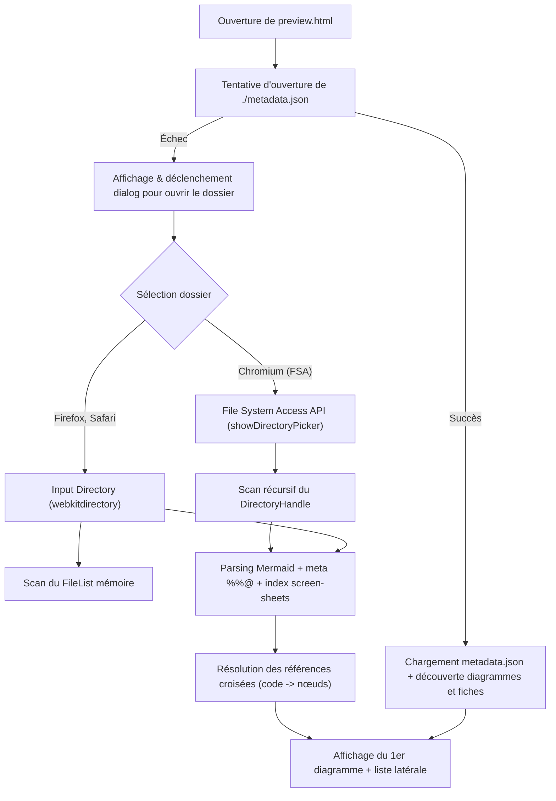
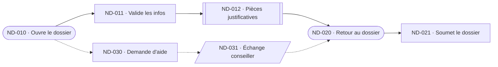
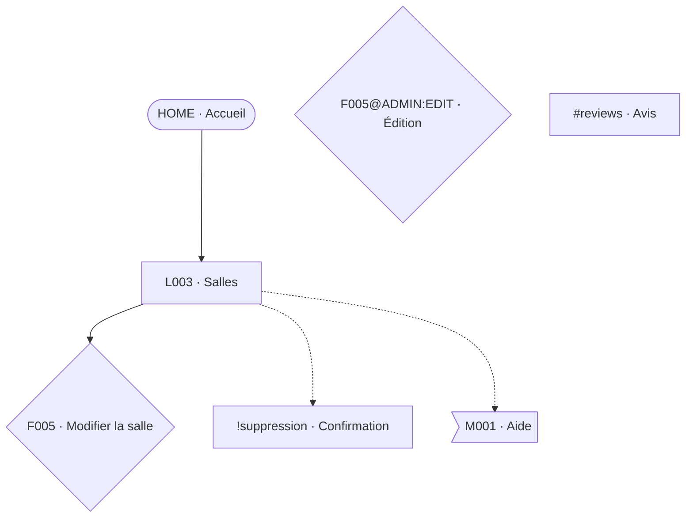

# Spécification fonctionnelle et technique du Visualiseur Unifié (`preview.html`)

> **Rôle du document** : Spécification d'accompagnement — Outil de visualisation unifié  
> **Document parent** : [Information Architecture — Global Documentation](../../specs/documentation-architecture-information.md)  
> **Documents frères associés** :
> - [Information Architecture — Part 1: Arborescence Specification](../../specs/spec-arborescence.md)
> - [Information Architecture — Part 2: Userflows Specification (Journey Graph)](../../specs/spec-userflows.md)  
> **Version** : 1.4 — Octobre 2026  
> **Statut** : Validé (révision v1.4 : distinction UC dossier / Parcours PF empilés verticalement avec nominaux en haut, centrage direct sur coordonnées réelles du nœud sans animation de rebond SVG, épuration des mentions redondantes avec la meta)  

---

> [!IMPORTANT]
> **Règle de langue des livrables :**
> Conformément aux règles du projet (`GEMINI.md`), ce document de spécification est rédigé en français tout en préservant intacts l'ensemble des identifiants techniques, noms de fichiers, classes CSS et jetons de modélisation (`preview.html`, `generated/`, `metadata.json`, `screen-sheets/`, `HOME`, `L001`, `C001:EDIT`, `L003!suppression`, `FEAT-xxx`, `ND-xxx`, `!`, `#`, `⏸`, `key=VALUE`).

---

## 0. Synthèse des évolutions v1.3 → v1.4

| # | Sujet | v1.3 | v1.4 |
| :--- | :--- | :--- | :--- |
| 1 | **Distinction Cas d'Usage (UC) vs Parcours (PF)** | Un UC était traité comme un diagramme `.mmd` ordinaire (`UC-xxx-overview.mmd`) au même niveau que les parcours | **Modèle Dossier UC ➔ Parcours empilés** : Un Cas d'Usage (`UC-xxx`) est un conteneur logique (dossier repliable dans `#sidebar`) regroupant tous les parcours (`PF-*.mmd` portant `uc=UC-xxx`) qui l'exécutent. Cliquer sur le dossier UC ouvre un canevas composite affichant tous les parcours de l'UC **empilés verticalement les uns au-dessus des autres**, avec les **parcours nominaux (`statut=nominal`) en haut**, suivis des variantes (`statut=variante`) et des segments (`statut=segment`). |
| 2 | **Centrage sur un nœud & suppression du rebond** | L'animation `.pulse` (`transform: scale`) écrasait l'attribut SVG `transform="translate(x,y)"` (faisant sauter le nœud en `(0,0)`), et `getBBox()` renvoyait `(0,0)` au lieu des coordonnées du canevas | **Centrage mathématique exact sans rebond** : Suppression de toute animation CSS `transform` / `pulse` sur les `<g class="dg-card">`. `centerOnNode` lit directement les coordonnées canevas (`data-x`, `data-y`, `data-w`, `data-h`) et compense la largeur de l'inspecteur latéral ouvert pour centrer le nœud dans la zone visible. |
| 3 | **Non-redondance des titres avec la meta** | Les titres contenaient des mentions redondantes (`"Cas d'Usage : ..."`, `"Segment : ..."`, `"Variante"`, `"(Hub)"`, `"(Popin)"`) | **Titres métier purs** : Aucune mention de type ou de statut (`"Cas d'Usage"`, `"Segment"`, `"Variante"`, `"Nominal"`, `"Vue Repliée"`, `"(Hub)"`, `"(Popin)"`, `"(Modale)"`, `"(Ancre)"`) dans les libellés et titres ; ces informations sont portées exclusivement par la meta (`kind`, `view`, `statut`, `type`, `subtype`). |
| 4 | **Optimisations mémoire & rendu** | Écouteurs d'événements individuels recréés à chaque rendu et fuite de `window.addEventListener('mousemove')` | **Délégation d'événements unique** sur le conteneur SVG (survol et clic), chargement parallèle (`Promise.all`) des fichiers et enrichissement O(1) des cartes `ECR` depuis l'arborescence. |

---

## 0.bis Synthèse des évolutions v1.2 → v1.3

| # | Sujet | v1.2 | v1.3 |
| :--- | :--- | :--- | :--- |
| 1 | **Panneau Légende** | Éléments non stylisés en flux DOM brut, visuel cassé | **Panneau modal flottant structuré** avec header, bouton de fermeture, et 3 sections thématiques soignées (*Composants*, *Liaisons & Lignes*, *Bulles & Statuts*). |
| 2 | **Bouton Exporter** | Bouton `primary` (bleu vif) dominant la barre d'outils | **Bouton d'outil neutre standard** (`btn-tool`) : l'export est une action secondaire, la fonction principale restant l'exploration. |
| 3 | **Netteté & Rastérisation** | Texture bitmap compositée GPU avec `will-change: transform` provoquant un flou persistant | **Transformation vectorielle directe** sur `<g id="viewport-content">` natif SVG : zéro flou, zéro pixellisation, netteté vectorielle 100% à tous les niveaux de zoom (`0.15x` à `4.0x`). |
| 4 | **Canevas & Centrage** | Boîte finie avec fond pointillé délimité et diagramme décentré | **Canevas vectoriel infini** couvrant 100% du viewport (`patternTransform` synchronisé) et **centrage automatique mathématique** (`fitToBounds`) au chargement et au changement de diagramme. |
| 5 | **Alignement Y des Userflows** | Marches d'escalier / zigzags verticaux causés par `variant`/`diverge` | **Alignement horizontal strict sur l'axe Y** : les étapes du flux nominal et des parcours linéaires partagent une coordonnée `Y` strictement identique, avec couloirs dédiés pour les variantes. |
| 6 | **Sémantique des Liaisons** | Lignes aux styles différents sans documentation dans la légende | **Spécification normative complète et swatches de légende** pour les 4 familles de liaisons (nominal/hiérarchie, variante/renvoi, CALL violet, EXT orange). |
| 7 | **Chargement initial & repli dossier** | Découverte HTTP conditionnelle stricte ; pas de tentative d'ouverture sous `file://` | **Tentative systématique d'ouverture de `metadata.json`** à côté de `preview.html`. En cas d'échec ou d'absence de diagrammes, déclenchement et affichage automatique de la dialog d'ouverture de dossier (`showDirectoryPicker()` / dialogue de fichier). |
| 8 | **Glisser-Déposer direct de `metadata.json` & Entête de version** | Glisser-déposer d'un fichier JSON seul non pris en charge ; métadonnées non versionnées | **Prise en charge du glisser-déposer de `metadata.json` seul ou avec `.mmd`** à tout moment. Entête normatif (`header`) avec `format`, `version` et `template_version` permettant au Studio d'adapter son comportement aux différentes versions de templates. Rétrocompatibilité totale avec l'ancien format dictionnaire direct. |

---

## 0.bis Rappel des évolutions v1.1 → v1.2

| # | Sujet | v1.1 | v1.2 |
| :--- | :--- | :--- | :--- |
| 1 | **Architecture source** | Fichier HTML unique monolithique | **Sous-projet modulaire `studio/`** avec `package.json`, Vite singlefile, JS et CSS découpés dans `src/`, distribution unique dans `dist/preview.html`. |
| 2 | **Bibliothèque d'icônes** | Emojis et glyphes approximatifs | **Google Material Symbols (Material Icons)** via CDN officiel Google Fonts. |
| 3 | **Layout Arborescence** | Calcul séquentiel (frères pouvant se superposer) | **Algorithme récursif de bounding box** : réservation de l'espace de sous-arbre garantissant que les frères (`D001`, `E404`) sont placés **côte à côte** à droite de `L001`. |
| 4 | **Titres de cartes** | Répétition de l'ID (`ND-001 · Accueil`) | **Titre épuré sur 2 lignes max** sans répétition de l'ID (déjà en bas à droite). |
| 5 | **Gestion des URLs** | URL unique affichée | **URL relative** sur la carte et **URL absolue canonique** calculée par concaténation ascendante dans l'inspecteur. |
| 6 | **Liens de Userflow** | Traits invisibles (seule la tête de flèche visible) | **Tracés vectoriels `<path>` avec `stroke` garanti** et flèches orientées. |
| 7 | **Étapes ACT (Actions)** | Chips étroites provoquant des sauts au survol | **Carte page standard sans bordure** avec icône Material Symbol dédiée (`ads_click`). |
| 8 | **Inspecteur de nœud** | Volet latéral statique | **Panneau modal interactif** avec recentrage automatique du canevas et navigation cliquable continue **Parent direct ↔ Enfants directs**. |
| 9 | **Rendu du canevas** | `radial-gradient` CSS créant un moiré pixelisé | **Motif vectoriel SVG natif `<pattern>`** 100% net à tous les niveaux de zoom (`0.15x` à `4.0x`). |
| 10 | **Contrôles & Export** | Boutons éparpillés dans la barre d'outils | **Barre d'outils flottante au-dessus du canvas** (Calques, Légende, Diags, Zoom) + **Menu déroulant d'export unifié** (*SVG*, *PNG*, *PNG HD*, *Print*). |
| 11 | **Validation & Tests** | Tests manuels uniquement | **Suite de tests automatisés (Vitest)** pour le parseur, la hiérarchie d'URLs, le layout et le rendu SVG. |

---

## 1. Objet et Philosophie du Visualiseur

Le fichier `preview.html` constitue le **visualiseur unifié autonome** de l'ensemble des livrables graphiques et documentaires générés pour un projet d'Architecture de l'Information (IA) : arborescences (sitemaps) et userflows.

### 1.1 Objectifs clés
1. **Visualiseur unique** : charger, afficher, filtrer et inspecter tous les diagrammes (`sitemap-*.mmd`, `UC-*-overview.mmd`, `PF-*-*.mmd`…) et leurs métadonnées dans un répertoire cible (par défaut `generated/`).
2. **Habillage piloté par la meta** : l'apparence d'un élément dépend de son **type, état, variante, rôle, accès, tags**… Ces informations sont stockées dans les fichiers `.mmd` (meta de fichier ou de nœud, §2.4). Elles ne gênent pas la lecture dans un lecteur Mermaid standard ; elles ajoutent le style dans le visualiseur.
3. **Navigation entre livrables** : un même objet (page) apparaît dans l'arbo et dans les parcours ; le visualiseur permet de passer de l'un à l'autre (« voir dans l'arbo », « voir dans les parcours »).
4. **Autonomie totale** : un fichier HTML5 unique, CSS et JavaScript vanilla, sans build. Fonctionne en `file://` comme derrière un serveur local (`ia-tools preview`).
5. **Inspection contextuelle** : survol (aperçu rapide) et clic (inspecteur complet : URL, template, rôles, accès, `ctx_in`/`ctx_out`, signaux de tracking, fiche écran).

### 1.2 Principes directeurs

| ID | Principe |
| :--- | :--- |
| **P1** | Un `.mmd` reste **valide et lisible** dans n'importe quel lecteur Mermaid : la meta vit dans des commentaires `%%@`, que ces lecteurs ignorent. |
| **P2** | Le `.mmd` ne porte **aucun style** (`classDef`, `style`, `linkStyle`, `:::`, HTML inline). Si ces éléments existent dans un fichier hérité, ils sont **ignorés** par le visualiseur. |
| **P3** | La **topologie** (nœuds, liens, regroupements) vient du code Mermaid ; la **sémantique** (type, état, variante…) vient de la meta. Les deux ne se dupliquent pas. |
| **P4** | Le visualiseur travaille sur la **structure**, pas sur les contenus : libellés, URL et textes sont affichés tels quels, sans jugement de cohérence (cf. §11 : seuls des contrôles structurels sont proposés). |
| **P5** | Les fichiers `.mmd` sont **générés à partir de templates prédéfinis** : le visualiseur est en **lecture seule** et n'édite jamais les fichiers. |
| **P6** | Une **dégradation gracieuse** est garantie : sans meta, le visualiseur déduit ce qu'il peut du libellé et des formes, et affiche quand même le diagramme (§2.4.5). |
| **P7** | Les **écrans** d'un userflow utilisent **strictement le même composant visuel** que les pages d'une arborescence (§3.3). |
| **P8** | Le visualiseur est un **moteur neutre à chargement dynamique** : aucun contenu `.mmd` ou donnée métier n'est inliné ou incorporé en dur dans son bundle. Tous les diagrammes, métadonnées et fiches écrans sont chargés dynamiquement à la volée (via HTTP `fetch`, File System Access API ou drag & drop). L'outillage peut ainsi régénérer ou modifier les `.mmd` sans jamais avoir à reconstruire `preview.html`. |

---

## 2. Architecture des Données et Ingestion

### 2.1 Arborescence du dossier ingéré

```
generated/
├── preview.html                     <-- Visualiseur unifié autonome
├── metadata.json                    <-- Registre indexé des métadonnées détaillées (par code)
├── sitemap-overview.mmd             <-- Arborescence générale
├── sitemap-detailed.mmd             <-- Arborescence détaillée (variantes, modules, renvois)
├── sitemap-by-role.mmd              <-- Arborescence filtrée par rôle
├── UC-xxx-overview.mmd              <-- Vue d'un cas d'usage (parcours regroupés)
├── PF-xxx-collapsed.mmd             <-- Parcours (vue repliée)
├── PF-xxx-expanded.mmd              <-- Parcours (sous-parcours dépliés)
└── screen-sheets/                   <-- Fiches écrans Markdown synthétiques
    ├── screen-HOME.md
    └── screen-L001.md
```

### 2.2 Sources de données ingérées
1. **Diagrammes Mermaid (`*.mmd`)** : code Mermaid + meta `%%@` (§2.4). Les métadonnées sont portées exclusivement par les directives en commentaires `%%@file`, `%%@node`, `%%@edge` (politique de migration stricte vers `%%@file`, sans frontmatter YAML).
2. **Registre `metadata.json`** : données **lourdes** indexées par `code` (`ctx_in`, `ctx_out`, signaux de tracking, rupture). Chargé au démarrage, à la demande (survol enrichi, inspecteur) ou par glisser-déposer direct sur `preview.html`.
   - **Entête normatif (`header`)** :
     - `header.format` : Identifiant du format (par défaut `"ia-metadata"`).
     - `header.version` : Version du schéma de métadonnées (ex. `"1.3.0"`).
     - `header.template_version` : Version cible des templates de diagrammes (ex. `"1.3.0"`), permettant au Studio d'adapter son comportement aux différentes versions de templates et de signaler d'éventuelles incompatibilités.
     - `header.project` : Métadonnées de projet contextuelles (nom, date, auteur).
   - **Corps des entités (`entities`)** : Dictionnaire d'objets indexé par `code` d'écran/nœud.
   - **Glisser-Déposer direct** : L'utilisateur peut à tout moment glisser-déposer son fichier `metadata.json` sur la fenêtre pour actualiser instantanément l'ensemble des données d'inspection et de conformité sans rechargement.
   - **Rétrocompatibilité assurée** : Studio gère nativement le format historique plat sans entête (`{ "HOME": { ... } }`).
3. **Fiches écrans (`screen-sheets/screen-*.md`)** : entrées, sorties, fonctionnalités, contextes et événements d'un écran.

### 2.3 Pipeline de découverte et modes de chargement



- **Ouverture initiale de `metadata.json`** : au chargement, `preview.html` tente d'ouvrir `metadata.json` situé à côté de lui (`fetch('./metadata.json')`). En cas de succès, il découvre les diagrammes `.mmd` (via index de répertoire local ou sondage des fichiers standards) et pré-charge les fiches écrans Markdown.
- **Repli automatique sur la sélection de dossier** : si `metadata.json` ne peut être ouvert (restrictions de sécurité `file://`, fichier absent, erreur réseau) ou si aucun diagramme n'est trouvé, l'état d'ouverture s'affiche et la boîte de dialogue de sélection de dossier (`showDirectoryPicker()` avec repli input file) est immédiatement déclenchée.
- **Mode A — File System Access API** (Chromium / Edge / Opera) : `showDirectoryPicker()`, handle conservé (`activeDirectoryHandle`) pour rafraîchir sans rouvrir la boîte de dialogue.
- **Mode B — Fallback FileList** (Firefox / Safari) : `<input type="file" webkitdirectory directory multiple>` ; classement via `webkitRelativePath`.
- **Mode C — Auto-fetch HTTP local** : sous serveur HTTP, `fetch('./metadata.json')` pré-charge les métadonnées.
- **Index global** : tous les fichiers chargés alimentent un index unique `code → [(fichier, nœud)]`, indispensable à la navigation croisée (§6.3).

### 2.4 Grammaire de la meta `%%@`

> Grammaire **validée** (octobre 2026). Les ajouts de la v1.1 sont regroupés au §2.4.6.

#### 2.4.1 Syntaxe

```
%%@file  key=VALUE key=VALUE ...
%%@node  <id> key=VALUE ...
%%@edge  <src>><dst> key=VALUE ...
```

- Une directive par ligne, `%%@` en début de ligne. Pour Mermaid, c'est un commentaire : la ligne est ignorée.
- `VALUE` : mot sans espace, ou texte entre guillemets doubles (`label="Liste des salles"`). Listes : valeurs séparées par des virgules, sans espace (`roles=ADMIN,BUYER`).
- Ordre des clés libre ; clés inconnues **conservées** et affichées dans l'inspecteur (compatibilité ascendante).
- Plusieurs `%%@file` sont fusionnés ; en cas de clé répétée, la dernière gagne (avertissement).
- Les directives peuvent être placées n'importe où, de préférence en tête de fichier (avant `flowchart`) pour `%%@file`, puis regroupées par type.
- `%%@node` ne **crée jamais** de nœud : il annote un nœud déclaré dans le code Mermaid. Idem pour `%%@edge`, qui annote un lien existant (appariement par `<src>><dst>` ; si plusieurs liens relient la même paire, appariement dans l'ordre de déclaration).

#### 2.4.2 Directives et clés

**`%%@file`**

| Clé | Valeurs | Rôle |
| :--- | :--- | :--- |
| `id` | slug unique par projet | Identifiant du diagramme |
| `project` | slug | Périmètre : borne la navigation croisée et la collision de codes |
| `kind` | `sitemap` / `userflow` / `reference` | Catégorie (badge de la liste latérale) |
| `view` | `general` / `detailed` / `role` / `uc` / `collapsed` / `expanded` | Niveau de vue |
| `role` | code de rôle | Rôle filtré (vue par rôle) |
| `roles` | liste | Rôles concernés par le diagramme |
| `uc`, `obj` | identifiants | Rattachement cas d'usage / objectif |
| `statut` | `nominal` / `variante` / `segment` | Statut du parcours |
| `diverge`, `rejoint` | `PF-xxx@N` | Points de divergence / rejonction d'une variante |
| `atterrissage` | code de page | Écran d'atterrissage d'un parcours |
| `confiance`, `validation`, `funnel` | valeurs du template UC | Informations de suivi (affichées dans l'en-tête) |
| `title`, `version` | texte | Titre / version (surchargent le frontmatter) |

**`%%@node <id>`**

| Clé | Valeurs | Rôle |
| :--- | :--- | :--- |
| `code` | `CODE[@ROLE][:VARIANTE]` + suffixe `!x` ou `#x` | **Code canonique** (clé de navigation croisée) |
| `type` | voir §2.4.4 | Détermine la famille de rendu |
| `subtype` | texte court (`datagrid`, `stepper`, `form`…) | Libellé de type affiché (ligne 2, bas-droite) |
| `access` | `public` / `protected` | Accès |
| `roles` | liste | Rôles habilités |
| `url` | chemin canonique (`/rooms/[id]`) | URL de la page |
| `order` | entier | Ordre d'affichage / numéro d'étape |
| `ref` | `FEAT-xxx` / `PF-xxx` / texte | Référence portée par le nœud (ACT, CALL, EXT…) |
| `obs` | `url` / `event` / `none` | Observabilité du nœud |
| `break`, `resume`, `persist`, `delay` | `yes` ; id de nœud ; `volatile` / `persistent` / `external` ; durée | Rupture déclarée (⏸) |
| `scope` | `ALL` / `PUBLIC` / `AUTH` / `@ROLE` | Portée d'un module transverse |
| `icon`, `tags`, `who`, `tone`, `urlmode`, `dynamic`, `label` | cf. §2.4.6 | Extensions |

**`%%@edge <src>><dst>`**

| Clé | Valeurs | Rôle |
| :--- | :--- | :--- |
| `kind` | `navigation` / `action` / `invoke` / `attach` (sitemap) ; `nominal` / `variant` / `diverge` / `rejoin` (userflow) | Nature du lien |
| `trigger` | `click` / `submit` / `auto` / `system`… | Déclencheur |
| `ref` | `FEAT-xxx` | Fonctionnalité portée (renvoi fonctionnel, ouverture de popin) |
| `ctx` | `cle=VALEUR ; cle=VALEUR` | Contexte produit |

#### 2.4.3 Code canonique et identifiant Mermaid

Les identifiants de nœud Mermaid n'acceptent pas `@`, `:`, `!`, `#`, `/`. On sépare donc :

- **`<id>` Mermaid** : technique, `[A-Za-z0-9_]`, jamais utilisé pour la logique ;
- **`code`** : forme canonique, seule clé de correspondance.

Grammaire du `code` :

```
code      := BASE [ "@" ROLE ] [ ":" VARIANTE ] [ "!" popin | "#" ancre ]
BASE      := HOME | H|L|F|C|D|E|M  +  chiffres  (ex. L001, C010, M001)
Exemples  := HOME  L001  L001:EDIT  L001@ADMIN  L001@ADMIN:EDIT
             L003!suppression      (dialog « suppression » sur la page L003)
             C001#reviews          (ancre interne « reviews » de C001)
```

Convention d'`id` Mermaid recommandée (générateur) : `L003!suppression` → `L003_dlg_suppression` ; `C001#reviews` → `C001_anc_reviews` ; `C001@ADMIN:EDIT` → `C001_ADMIN_EDIT`.

Un code suffixé par `!` ou `#` désigne un **élément rattaché** à la page de base (`L003`).

#### 2.4.4 Vocabulaires contrôlés

| Famille | Valeurs `type` | Libellé affiché par défaut |
| :--- | :--- | :--- |
| Pages (sitemap) | `HOME` | Homepage |
| | `H` | Hub |
| | `L` | Liste |
| | `F` | Formulaire |
| | `C` | Contenu |
| | `D` | Dashboard |
| | `E` | Page technique (**à confirmer**, cf. §13) |
| Éléments rattachés | `DLG` (popin / prompt, `!`), `ANC` (ancre, `#`) | Popin / Ancre |
| Modules transverses | `MOD` (code `M###`, hors arbre) | Module |
| Entités de parcours | `ECR`, `ACT`, `ATT`, `EXT`, `CALL` | Écran, Action, Attente, Externe, Sous-parcours |

`subtype` (texte libre court) **remplace** le libellé par défaut quand il est présent (ex. `datagrid`, `stepper`, `select`, `page hub`).

#### 2.4.5 Dégradation gracieuse (fichier sans meta)

| Information manquante | Déduction |
| :--- | :--- |
| `code` | Premier mot du libellé s'il respecte la grammaire du code (`L001 /rooms` → `L001`) ; sinon pas de navigation croisée pour ce nœud |
| `url` | Premier mot du libellé commençant par `/` |
| `type` (sitemap) | Lettre du code (`L`, `C`, `F`…) |
| `type` (userflow) | Forme Mermaid : stade `([ ])` = ECR ; rectangle = ACT ; hexagone `{{ }}` = ATT ; parallélogramme `[/ /]` = EXT ; double bord `[[ ]]` = CALL |
| `access` | Mot « protégée » dans le libellé |
| `kind` d'un lien | Trait plein = `navigation` (sitemap) ou `nominal` (userflow) ; pointillé = `attach` / `action` / `invoke` selon la cible, ou `variant` (userflow) |
| `break` | Symbole `⏸` dans le libellé |

Un bandeau discret signale « fichier sans meta : habillage déduit » ; le diagramme reste utilisable.

#### 2.4.6 Extensions proposées à la grammaire validée

Ces ajouts ne cassent pas la grammaire validée (clés optionnelles). **À accepter ou refuser** :

| Ajout | Forme | Pourquoi |
| :--- | :--- | :--- |
| `%%@tag <NOM>` | `%%@tag SP1 color=green style=outline label="Sprint 1"` | Déclare la couleur et le style d'un tag (palette §3.5) et alimente la légende. Sans déclaration : gris, contour. |
| `tags` | `tags=SP1,MVP` | Tags d'un nœud |
| `icon` | `icon=device,a11y` | Bulles d'icône (registre §3.5) |
| `who` | `who=ADMIN,BUYER` | Avatars / personnes associés (§3.5) |
| `tone` | `tone=accent` | Fond d'accentuation (le fond lavande des captures, §3.4) |
| `urlmode` | `urlmode=abs` / `rel` | Force l'affichage « Absolu » / « Relatif » de l'URL (§3.3) |
| `dynamic` | `dynamic=yes` | Force la pile « page dynamique » (sinon déduit de `[x]` ou `:x` dans `url`) |
| `label` | `label="Nom affiché"` | Surcharge du titre affiché |
| `subtype` | `subtype=datagrid` | Libellé de type fin (ligne 2 de la carte) |

---

## 3. Design System

Les captures de référence (arbo, flows, components) définissent le langage visuel. Seuls la **structure** et le **style** comptent ; les contenus qu'elles montrent sont ignorés. Les valeurs numériques ci-dessous sont **estimées à partir des captures** et doivent être calibrées au rendu final (bloc de tokens en annexe B).

### 3.1 Principes
1. **Cartes blanches, traits fins, couleur rare** : la couleur est réservée au sens (page d'accueil, appel de sous-parcours, événement externe, tags, bulles).
2. **Un seul composant « Carte Page »** pour les pages d'arbo **et** les écrans de parcours (P7).
3. **Information en périphérie, nom au centre** : le nom de la page est lisible d'un coup d'œil ; le reste (URL, code, type) est discret, aux coins.
4. **Hiérarchie = trait plein coudé ; renvoi = pointillé clair.**
5. **Lisibilité à la mise à l'échelle** : tout est exprimé en tokens relatifs à la taille de carte.

### 3.2 Tokens

| Famille | Token | Valeur (clair) | Usage |
| :--- | :--- | :--- | :--- |
| Canvas | `--dg-canvas` / `--dg-dot` | `#f5f5f5` / `#cfcfcf` | Fond pointillé |
| | `--dg-frame` / `--dg-frame-border` | `#ffffff` / `#e5e5e5` | Cadre (frame) de userflows, rayon 8 px |
| | `--dg-level-line` | `#d9d9d9` | Lignes de niveau (arbo), 1 px |
| Carte | `--dg-card` / `--dg-card-border` | `#ffffff` / `#d4d4d4` | Fond / bordure 1 px |
| | `--dg-radius` | `5px` | Arrondi |
| | `--dg-card-shadow` | `0 1px 3px rgba(0,0,0,.18)` | Ombre légère |
| | `--dg-card-w` × `--dg-card-h` | `200 × 118` px | Ratio ≈ 1,7 (identique aux captures) |
| Accents | `--dg-home` | `#3232f5` | Bordure 3 px de la homepage |
| | `--dg-fill-state` | `#dbe6ec` (bord `#c5d3db`) | Fond des variantes / états |
| | `--dg-fill-accent` | `#ebebfb` (bord `#d6d6f2`) | Fond d'accentuation |
| | `--dg-stack-1` / `--dg-stack-2` | `#f3f3f3` / `#e8e8e8` | Couches de la pile « dynamique » |
| Texte | `--dg-title` | `#222222`, 14 px, 700 | Nom de la page |
| | `--dg-url` / `--dg-muted` | `#6b6b6b` (10 px) / `#a8a8a8` (8 px) | URL / mode URL |
| | `--dg-code` / `--dg-type` | `#333333` / `#777777` (9 px) | Code / type |
| Liens | `--dg-edge` | `#666666`, 1,5 px | Hiérarchie, nominal |
| | `--dg-edge-cross` | `#a3a3a3`, 1,5 px, pointillé `6 4` | Renvois, variantes |
| Entités | `--dg-call` | `#8b4dff` | Sous-parcours (CALL) |
| | `--dg-ext` | `#ff9500` | Événement externe (EXT) |
| | `--dg-att` | `#8a8f9b` | Attente (ATT) |
| Tags | `--tag-blue/red/gray/green/orange` | `#0f5bff` / `#f4153e` / `#8a8f9b` / `#7bcc0f` / `#ff8a14` | Palette des tags |
| Bulles | `--bubble-peach/amber/blue/lavender` | `#fdd3b0` / `#fcc36b` / `#a6d3f6` / `#d2c5f4` | Fond des bulles d'icône ; glyphe `#2b3a55` |
| Marqueurs | `--marker-violet` / `--marker-slate` / `--marker-green` | `#b5a1ee` / `#5d6475` / `#4a9a2c` | Pastilles de flux |
| Pastille | `--order-circle` | `#b7a6ea` | Numéro d'ordre |
| Police | `--dg-font` | `Inter, system-ui, "Segoe UI", sans-serif` | Pile avec repli système (export fiable) |
| Espacement | `--dg-gap-x` / `--dg-gap-y` | `48` / `72` px | Entre frères / entre niveaux (arbo) |
| | `--dg-flow-gap` | `88` px | Entre deux cartes d'un parcours |

### 3.3 Carte Page (composant commun)

```
           ╭───╮                                         ┌─────┐
           │ 📱│  bulle(s) d'icône                       │ SP1 │  tag(s)
 ┌─────────╰───╯─────────────────────────────────────────┴─────┴──────┐
 │ url/example/                                                        │  URL (segment)
 │ Relatif                                                             │  mode d'URL
 │                                                                     │
 │                         Nom de la page                              │  titre, 3 lignes max
 │                                                                     │
 │ (01)                                      template/VARIANT:STATE    │  pastille | code
 │                                           Type de page              │  type / sous-type
 └─────────────────────────────────────────────────────────────────────┘
```

| Emplacement | Position | Source | Règle |
| :--- | :--- | :--- | :--- |
| Bulle(s) d'icône | Coin haut-gauche, débordant de ~12 px | `icon` + icônes dérivées | 2 bulles max côte à côte (§3.5) |
| Tag(s) | Coin haut-droit, centrés sur la bordure haute, marge droite 10 px | `tags` | 3 visibles max, puis « +n » |
| Avatar(s) | Coin haut-droit, débordant ; les tags se décalent à gauche | `who` | Cercle, anneau blanc (§3.5) |
| URL | Haut-gauche, intérieur | `url` | Segment relatif ou chemin absolu (règle ci-dessous) |
| Mode d'URL | Sous l'URL | dérivé ou `urlmode` | `Relatif` ou `Absolu` |
| Titre | Centre, gras, centré | libellé du nœud ou `label` | 3 lignes max, ellipse au-delà (texte complet au survol) |
| Pastille d'ordre | Bas-gauche | `order` | Option « Numérotation » (§5.2) ; désactivée par défaut |
| Code | Bas-droite, ligne 1 | `code` | Affiché tel quel (`C010:EDIT`) |
| Type | Bas-droite, ligne 2 | `subtype`, sinon libellé du `type` | Gris, plus petit |

**Règle d'affichage de l'URL (déduite des captures)**
- Homepage : `/` en **Absolu**.
- En **arbo** : segment propre de la page **relatif** à celui de son parent (`/rooms/[id]` sous `/rooms` → `[id]/`).
- En **parcours** : **Relatif** quand la page est un enfant hiérarchique du nœud précédent du parcours (d'après l'arbo) ; **Absolu** sinon.
- Élément rattaché : `!suppression` (popin) ou `#reviews` (ancre), en **Relatif** à la page de base.
- Surcharge possible par `urlmode`.

**Source des informations pour un écran de parcours** : `code` est résolu dans l'arbo ; URL, code et type en proviennent (l'arbo est la source de vérité des pages). Le titre vient du libellé du nœud (préfixe `ND-xxx` retiré), à défaut du nom de page dans l'arbo. Une meta locale peut surcharger.

### 3.4 Variantes de carte

| Cas | Rendu | Déclencheur |
| :--- | :--- | :--- |
| Page standard | Blanc, bordure 1 px | Par défaut |
| Homepage | Bordure **3 px** `--dg-home`, URL `/` Absolu | `type=HOME` |
| Variante / état | Fond `--dg-fill-state` ; code au format `template-état` ou `/VARIANTE:ÉTAT` | `code` contenant `:` |
| Accentuée | Fond `--dg-fill-accent` | `tone=accent` |
| Page dynamique | **Pile** de 2 couches décalées de 6 px en bas-droite (`--dg-stack-1`, `--dg-stack-2`) | `url` contenant `[x]` ou `:x`, ou `dynamic=yes` |
| Protégée | Bulle cadenas (gris ardoise) | `access=protected` |
| Non observable | Bordure pointillée | `obs=none` |
| Rupture déclarée | Marqueur « pause » (⏸) | `break=yes` |
| Popin / ancre | Carte standard ; URL `!nom` ou `#nom` ; type « Popin » / « Ancre » | `type=DLG` / `ANC` |
| Module transverse | Bordure pointillée + puce de portée (`ALL`, `AUTH`, `@ROLE`) | `type=MOD` |
| Service externe | Bordure orange `--dg-ext` (2 px) ; type « Externe » ; URL externe (`ext://...` ou `https://...`) | `type=EXT` ou code `EXT-*` |

Les cas sont **cumulables** (ex. dynamique + variante + protégée). Précédence du fond : `tone` explicite > variante dérivée > blanc.

> Dans les captures, deux fonds colorés coexistent : bleu-gris (page « état » du panneau components) et lavande (pages `new/` de l'arbo). Le visualiseur les modélise respectivement par la variante dérivée et par `tone=accent`. Le sens métier du fond lavande est à confirmer (§13).

### 3.5 Bulles, tags, avatars et marqueurs

**Bulles d'icône** — pastille ronde (~34 px) avec petite queue en bas-droite, glyphe `#2b3a55` :

| Icône | Couleur | Lecture proposée |
| :--- | :--- | :--- |
| `device` (téléphone) | pêche | Particularité d'appareil / responsive |
| `a11y` (personne) | ambre | Accessibilité |
| `entry` (cible) | bleu clair | Point d'entrée |
| `info` (« i ») | lavande | Information |
| `lock` (cadenas, ajout) | ardoise | Page protégée (dérivée de `access`) |

**Tags** — rectangle arrondi (rayon 3 px, ~20 px de haut), texte 10 px gras. Palette : 5 couleurs (bleu, rouge, gris, vert, orange) × 2 styles :
- `fill` : fond plein, texte blanc ;
- `outline` : bordure 2 px, fond teinté à 12 %, texte sombre.

Exemple des captures : `SP1` vert contour, `SP2` orange contour, `SP3` rouge contour, `MVP` dans les 10 combinaisons.

**Avatars** — cercle ~28 px, anneau blanc 2 px, ombre légère, chevauchement −8 px. Pas de photo : initiales calculées avec repli automatique (priorité à `who=` si présent, sinon repli sur `roles=`) sur fond de couleur stable (hachage du rôle). Affichage activable via le calque « Avatars » (§5.2, masqué par défaut).

**Marqueurs d'arborescence** — pastilles réservées exclusivement aux arborescences (aucun marqueur sur les userflows, qui restent sobres et épurés) :

| Marqueur | Forme | Signification |
| :--- | :--- | :--- |
| ● 01 | cercle violet | Numéro d'ordre (`order`), activable via le calque « Numérotation » |
| ● personne | cercle ardoise | Un rôle associé |
| ● groupe | cercle ardoise | Plusieurs rôles associés |

### 3.6 Liaisons & Styles de Lignes

Les liaisons entre entités sont formalisées selon 4 styles canoniques portant une sémantique métier précise et rigoureuse :

| Lien / Style | Rendu visuel | Sémantique en Arborescence (`kind=sitemap`) | Sémantique en Userflows (`kind=userflow`) | Notation Mermaid |
| :--- | :--- | :--- | :--- | :--- |
| **Trait continu sombre** | Trait plein `--dg-edge` (1,5 px), flèche pleine | **Lien hiérarchique direct** : relation structurelle parent ➔ enfant dans l'arbre | **Flux nominal / Chemin principal** : enchaînement séquentiel nominal standard entre écrans ou actions | `-->` |
| **Trait pointillé gris** | Trait pointillé `--dg-edge-cross` (1,5 px, tirets `6 4`), flèche ouverte | **Renvoi fonctionnel ou élément rattaché** : ouverture de popin (`!`), ancre interne (`#`), invocation de module (`M###`) | **Chemin alternatif / Variante** : divergence (`diverge`), étape d'une variante (`variant`) ou rejonction (`rejoin`) | `-.->` |
| **Trait violet** | Trait plein `--dg-call` (`#8b4dff`, 1,5 px), flèche violette | N/A (réservé aux parcours) | **Liaison issue d'un sous-parcours (CALL)** : sortie ou enchaînement consécutif à un sous-parcours réutilisable | Déduit si la source est `CALL` |
| **Trait orange** | Trait plein `--dg-ext` (`#ff9500`, 1,5 px), flèche orange | N/A (réservé aux parcours) | **Liaison issue d'un événement externe (EXT)** : reprise après échange hors application (email, conseiller, webhook) | Déduit si la source est `EXT` |

- **Étiquette de lien** : Pastille blanche centrée sur le tracé, texte 10 px (ex. `diverge @1`, `rejoint @4`, `FEAT-xxx`).
- **Survol de lien** : Le tracé passe à `--primary` (2,5 px) et affiche les détails dans la carte de survol (§6.1).

### 3.7 Éléments propres aux arborescences
- **Lignes de niveau** : une bande horizontale fine par profondeur, sur toute la largeur du canvas (option « Niveaux », activée par défaut).
- **Éléments rattachés** (`DLG`, `ANC`) : placés en colonne à droite de leur page, même niveau, reliés par un court pointillé `attach`.
- **Modules transverses** (`MOD`) : hors arbre, regroupés dans une bande « Modules transverses (hors arbre) » en pied de diagramme. Leurs liens `invoke` sont **masqués** par défaut et révélés au survol de la page ou du module (évite la surcharge).
- **Regroupements** Mermaid (`subgraph` de zones) : ignorés pour la mise en page ; la zone protégée s'exprime par `access`.

### 3.8 Éléments propres aux userflows

| Entité | Rendu | Détails |
| :--- | :--- | :--- |
| `ECR` | **Carte Page** strictement identique (§3.3) | Y compris homepage, pile, fond d'état |
| `ACT` | **Carte standard sans bordure** | Fond translucide neutre, icône Material Symbol `ads_click`, texte ACTION, libellé sur 2 lignes. Masquable via le calque « Actions » avec contraction de graphe (§3.10) |
| `CALL` | Carte à **bordure violette 2 px**, fond blanc, titre en gras (`PF-… — titre`) | Lien sortant violet. Vue dépliée : cadre violet pointillé contenant le sous-parcours |
| `EXT` | Carte à **bordure orange 2 px**, titre gras + sous-titre (`ref`) | Lien sortant orange. Point d'entrée de type notification, email, échange hors application |
| `ATT` | **Carte standard à bordure tiretée grise** | Bordure tiretée 1.5 px `--dg-att`, icône `schedule`, sous-titre `ATTENTE`, marqueur `⏸` si pause déclarée. Masquable via le calque « Attentes » avec contraction de graphe (§3.10) |
| Rupture ⏸ | Marqueur « pause » (cercle ardoise) en coin haut-gauche | Détails (mémoire, persistance, reprise, délai) au survol |

### 3.9 Masquage sélectif et Contraction Topologique de Graphe
Lors de la visualisation des parcours (`kind=userflow`), l'utilisateur peut choisir de masquer sélectivement les étapes d'action (`ACT`) et/ou les étapes d'attente (`ATT`) via le menu flottant des calques :
- **Contraction topologique transitive** : lorsqu'un nœud est masqué, il ne laisse aucun vide sur le canevas. Le moteur relie transitivement chaque nœud visible amont à chaque nœud visible aval en préservant la sémantique de lien (`nominal`, `variant`, `diverge`, `rejoin`).
- **Vue écrans seuls** : en décochant à la fois les actions et les attentes, l'utilisateur obtient la cinématique directe d'écran à écran (`ECR` ➔ `ECR` ➔ `CALL` ➔ `EXT`), recalculée avec un alignement strict sur l'axe Y et des espacements homogènes.

### 3.10 Légende automatique
Un panneau modal flottant repliable liste de façon dynamique et exhaustive, pour le diagramme affiché, l'ensemble des conventions graphiques :
1. **Composants & Cartes** : Homepage (bordure 3 px bleue), Page standard, État / Variante (fond bleu-gris), Accentuation (fond lavande), CALL violet, EXT orange, Action ACT (carte sans bordure, icône clic), Attente ATT (carte à bordure tiretée grise, icône horloge), Page dynamique (pile décalée).
2. **Liaisons & Lignes** : Trait continu sombre (hiérarchie ou nominal), Trait pointillé gris (variante ou renvoi), Trait violet (CALL), Trait orange (EXT).
3. **Bulles d'Icônes & Statuts** : Cadenas ardoise (`access=protected`), Smartphone pêche (`device`), Personne ambre (`a11y`), Cible bleue (`entry`), Numéro d'ordre violet (`order`), Symbole pause ardoise (`⏸`).

---

## 4. Moteur de Rendu et Mise en Page

### 4.1 Principe
Les cartes (plusieurs zones de texte, bulles, tags, piles, liens coudés, lignes de niveau) ne sont pas réalisables avec le rendu natif de Mermaid. Le visualiseur n'utilise donc **pas** le SVG de Mermaid : il **lit** le code et la meta, puis dessine lui-même.

```
.mmd ──> parse (code Mermaid + %%@) ──> AST ──> résolution (codes, parents)
      ──> mise en page (arbre / flux) ──> SVG ──> pan & zoom, survol, export
```

- Le SVG est construit par le visualiseur : `data-code`, `data-id`, `data-kind` sont posés **directement** (plus de réconciliation sur du texte rendu).
- Mermaid.js n'est chargé (CDN, à la demande) que pour la **vue Mermaid brute** (§4.6) et en **repli** si un fichier sort du sous-ensemble supporté.

### 4.2 Sous-ensemble Mermaid supporté

| Élément | Supporté |
| :--- | :--- |
| En-tête | `flowchart` / `graph` + `TD`, `TB`, `LR`, `RL`, `BT` |
| Nœuds | `id`, `id["t"]`, `id("t")`, `id(["t"])`, `id[["t"]]`, `id{"t"}`, `id{{"t"}}`, `id[/"t"/]`, `id>"t"]` |
| Liens | `-->`, `---`, `-.->`, `-.-`, `==>`, `===` ; chaînes `A --> B --> C` ; `A & B --> C` |
| Étiquettes de lien | `-->\|"t"\|`, `-. "t" .->`, `-- "t" -->` |
| Regroupements | `subgraph id["titre"]` … `end`, `direction` |
| Libellés | `<br/>` converti en saut de ligne |
| Ignorés | `classDef`, `class`, `style`, `linkStyle`, `click`, `:::classe` |
| Hors sous-ensemble | Autres types de diagrammes, syntaxe `@{ }` (Mermaid v11), HTML inline → **bandeau + repli** sur Mermaid.js |

### 4.3 Mise en page — arborescence (`kind=sitemap`)
1. **Racine** `HOME` en haut, centrée ; **niveau = profondeur**.
2. Le parent de chaque page est la source du premier lien `navigation` entrant ; **un seul parent par page** (sinon diagnostic, §11).
3. **Arbre compact** : chaque sous-arbre est centré sous son parent ; frères triés par `order`, puis ordre de déclaration ; écart horizontal `--dg-gap-x`.
4. Pas vertical : hauteur de carte + `--dg-gap-y`. Les **lignes de niveau** passent entre les niveaux.
5. Liens parent → enfants : coude avec bus horizontal à mi-hauteur de l'espace inter-niveaux.
6. **Éléments rattachés** : colonne latérale réservée (pas de chevauchement avec les frères).
7. **Modules** : bande dédiée en pied.
8. **Renvois** (`action`) : routage orthogonal le long des gouttières, pointillés clairs ; option « Renvois » pour les masquer.
9. **Vue par rôle** : si une meta `%%@file role=` est présente, le diagramme est affiché tel quel (déjà filtré). Un **filtre de rôle** est aussi proposé sur n'importe quelle vue (§5.1).

### 4.4 Mise en page — userflows (`kind=userflow`) et Cas d'Usage (`UC-xxx`)
1. **Direction gauche → droite** ; rang horizontal = plus long chemin depuis l'entrée (`ranks`) ; pas horizontal = largeur de carte + `--dg-flow-gap`.
2. **Alignement horizontal strict sur l'axe Y** :
   - **Ligne 0 (`row = 0`)** : chaque parcours (`PF-*.mmd`) est unitaire et strictement linéaire ; toutes ses étapes partagent une coordonnée `Y` strictement identique sans aucun décalage vertical (pas d'effet d'escalier ni de zigzag).
3. **ACT & ATT** : masquables via le menu des calques avec contraction topologique de graphe (§3.9).
4. **CALL** : carte à bordure violette pointant vers un sous-parcours ou segment (`PF-*-SEG`), ouvrable en un clic depuis l'inspecteur ou le survol.
5. **Distinction Cas d'Usage (`UC-xxx`) et Parcours (`PF-xxx`)** :
   - Un **Cas d'Usage (`UC-xxx`)** n'est pas un parcours : c'est un **dossier logique** qui regroupe l'ensemble des parcours (`PF-*.mmd` déclarant `uc=UC-xxx`) permettant d'exécuter l'UC et d'en respecter les objectifs.
   - Les métadonnées de l'UC (`title`, `objectifs`, `roles`) sont déclarées dans la clé `use_cases` de `metadata.json` ou via `uc_title` dans `%%@file`.
   - **Ouverture d'un Cas d'Usage (`layoutUseCase`)** : cliquer sur le dossier d'un UC dans le panneau latéral ouvre un canevas composite affichant **tous les parcours de cet UC empilés verticalement les uns au-dessus des autres** dans des cadres dédiés (`journeyTracks`), triés selon l'ordre normatif :
     1. **Parcours nominaux (`statut=nominal`) en haut** ;
     2. **Parcours variantes (`statut=variante`) au milieu** (avec indication de `diverge` / `rejoint`) ;
     3. **Segments réutilisables (`statut=segment`) et vues détaillées en bas**.
   - Cliquer sur un parcours individuel à l'intérieur du dossier UC dans le panneau latéral (ou sur le bouton « Isoler » dans l'inspecteur) affiche uniquement ce parcours seul sur le canevas.

### 4.5 Texte
- Retour à la ligne calculé par mesure (`measureText`) à la largeur de carte moins marges ; **3 lignes max**, ellipse ensuite.
- Texte complet toujours accessible au survol.

### 4.6 Vue Mermaid brute
Un bouton « Vue Mermaid » affiche le fichier tel que rendu par Mermaid.js, sans habillage. Sert à vérifier qu'un `.mmd` reste lisible dans un lecteur standard (P1).

---

## 5. Structure et Ergonomie de l'Interface

Modèle à trois panneaux réactifs, repris de la v1.0.

```
+----------------------------------------------------------------------------------------------------------+
| [IA Studio Visualizer]  [☀/🌙 Thème]  [📂 Ouvrir]  [🔄 Actualiser]                                        |
+--------------------------+-----------------------------------------------------------------+-------------+
| 🔍 [Rechercher...]       | [☰] Sitemap Detailed [SITEMAP]   [Calques ▾] [Légende] [Export] | Inspecteur  |
| [Tous][Arbos][Parcours]  |-----------------------------------------------------------------|-------------|
| Filtres: type · tag ·    |   ─ ─ ─ ─ ─ ─ ─ niveau 0 ─ ─ ─ ─ ─ ─ ─                         | Code: L001  |
|   rôle · état            |            ┏━━━━━━━━━━━━━┓                                      | Nom: Liste  |
|                          |            ┃ Page accueil┃                                      | URL: /rooms |
| > Sitemap Overview       |            ┗━━━━┯━━━━━━━━┛     ┌─────────────┐                   |-------------|
|   Sitemap Detailed       |   ─ ─ ─ ─ ─ ─ ─│─ niveau 1 ─ ─ │ Carte (hover)│ ─ ─ ─ ─         | Rôles ...   |
|   UC-001 — Overview      |            ┌────┴─────┐       │ ▸ Voir dans │                   | ctx_in ...  |
|   PF-001 — Collapsed     |            │  Carte   │       │   l'arbo    │                   | [Fiche]     |
+--------------------------+-----------------------------------------------------------------+-------------+
```

### 5.1 Panneau latéral gauche (`#sidebar`)
- Largeur 320 px, rétractable. En-tête : titre, bascule de thème, sélecteur de dossier, rafraîchissement.
- Recherche en temps réel sur `id`, `title`, `description`, et sur les **codes et libellés de nœuds** (résultat → ouvre le diagramme et centre le nœud).
- Pills : `Tous`, `Arbos` (badge `--badge-sitemap`), `Parcours` (badge `--badge-userflow`).
- **Filtres de diagramme** : type, tag, **rôle** (les nœuds hors rôle sont atténués à 25 %, jamais masqués), état/variante.
- **Organisation de la liste latérale** :
  - **Arborescences (`kind=sitemap`)** : éléments de premier niveau listés directement.
  - **Cas d'Usage (`UC-xxx`)** : présentés sous forme de **dossiers repliables/dépliables** (`.uc-folder`). Un clic sur l'en-tête du dossier UC ouvre sur le canevas l'ensemble des parcours de cet UC empilés verticalement (nominaux en haut). Le chevron permet de replier/déplier la liste des parcours enfants (`.uc-journey-item`) pour ouvrir un parcours spécifique isolément.

### 5.2 Zone centrale (`#main-viewport`)
- **Barre d'outils** : bascule du panneau latéral ; titre et badge ; **menu Calques** ; **Légende** ; exports (`PNG HD`, `PNG`, `SVG`, `Print`) ; bascule de l'inspecteur.
- **Calques** (cases à cocher structurées en 3 domaines) :
  - *Arborescence* : `Niveaux` (activé), `Renvois & modules` (activé), `Numérotation` (pastilles d'ordre, désactivé), `Couverture` (désactivé, cf. ci-dessous).
  - *Parcours (Userflows)* : `Actions (ACT)` (activé par défaut), `Attentes (ATT)` (activé par défaut) avec contraction topologique de graphe (§3.9).
  - *Général* : `Avatars` (désactivé), `Tags` (activé), `Vue Mermaid` (§4.6).
- **Calque Couverture** : en arbo, marque d'un trait pointillé rouge les pages qu'**aucun écran de parcours** ne référence (d'après l'index global), et affiche sur chaque page le **nombre de parcours** qui la traversent (cliquable → « voir dans les parcours »). Contrôle purement structurel.
- **Viewport** : fond pointillé `--dg-dot`, état vide invitant à charger `generated/`, wrapper de transformation pan & zoom, contrôles flottants `+`, `-`, `⛶` (ajuster), `1:1`.

### 5.3 Tiroir d'inspection (`#inspector`)
- 360 px, escamotable, alimenté au **clic**. Contenu : en-tête (code, libellé, URL) ; propriétés (type, sous-type, accès, variante/état, ordre) ; rôles ; tags ; `ctx_in` / `ctx_out` ; signaux de tracking ; rupture ⏸ (mémoire, persistance, reprise, délai) ; **liens croisés** (« Dans l'arbo », « Dans N parcours ») ; bouton « Fiche écran » si `screen-sheets/screen-{code}.md` existe.
- Les clés de meta inconnues sont listées en bas, sous « Autres propriétés ».

### 5.4 Modale de fiche écran (`#screen-sheet-modal`)
Inchangée : modale centrée, Markdown intégral en police monospace, fermeture par croix ou clic sur l'overlay.

---

## 6. Survol, Actions et Navigation Croisée

### 6.1 Carte de survol (aperçu)
Une carte flottante apparaît **200 ms** après l'entrée du pointeur sur un nœud (ou au focus clavier / au tap sur mobile) et reste ouverte tant que le pointeur est sur le nœud **ou** sur la carte. Elle ne bloque jamais le pan & zoom.

| Entité | Contenu de l'aperçu |
| :--- | :--- |
| Page (arbo / ECR) | Code, nom complet, type/sous-type, URL **absolue**, accès (🔒/🌐), rôles, variante/état, tags, nombre d'enfants (arbo), « Dans N parcours » |
| Popin / ancre | Code, page de base, fonctionnalité d'ouverture (`ref` du lien `attach`) |
| Module | Portée, invocation (`!help-panel`), pages d'appel |
| ACT | Libellé, `FEAT-xxx`, contexte produit, page de rattachement dans l'arbo |
| ATT / EXT | Description, observabilité, **rupture** (mémoire, persistance, reprise, délai) |
| CALL | `PF-xxx`, titre, nombre d'étapes, `ctx_in` / `ctx_out` |
| Lien | Nature (`kind`), déclencheur, `ref`, contexte produit |

### 6.2 Actions

La carte de survol se termine par une barre d'actions (les actions non pertinentes sont absentes, pas grisées).

| Action | Disponible sur | Comportement |
| :--- | :--- | :--- |
| **Voir dans l'arbo** | ECR, ACT, CALL (via sa page d'appel), nœuds de l'overview UC | Ouvre l'arbo et centre le nœud correspondant (§6.3) |
| **Voir dans les parcours** | Pages de l'arbo, popins | Liste les parcours qui contiennent le code ; choix → ouvre le parcours et centre l'écran |
| **Ouvrir la fiche écran** | Pages avec `screen-sheets/screen-{code}.md` | Ouvre la modale (§5.4) |
| **Copier le code** / **Copier l'URL** | Pages | Presse-papiers (retour visuel bref) |
| **Surligner les voisins** | Tous | Atténue le reste ; chemin entrant et sortant mis en évidence |
| **Déplier le sous-parcours** | CALL | Bascule en vue dépliée du parcours appelant |
| **Replier / déplier le sous-arbre** | Pages parentes (arbo) | Masque ou montre les descendants |

### 6.3 Résolution de « Voir dans l'arbo »

1. **Fichier cible** : parmi les arbos du même `project`, priorité à `view=detailed`, puis à une vue de rôle correspondant au rôle du parcours, puis à `general`. Si le code n'est pas dans la vue prioritaire, essai sur la suivante.
2. **Nœud cible** : correspondance **exacte** sur `code`. Sinon, repli progressif :
   - retrait de `:VARIANTE` → `C010:EDIT` devient `C010` ;
   - retrait de `@ROLE` → `C001@ADMIN` devient `C001` ;
   - pour `L003!suppression` ou `C001#ancre` : l'élément rattaché, sinon la page de base `L003` / `C001`.
3. **Pour un ACT** : le nœud rattaché à la fonctionnalité `ref=FEAT-xxx` (lien `action` ou élément portant la `ref`) ; à défaut, l'écran qui le précède dans le parcours.
4. **Retour visuel** : le diagramme s'ouvre, le nœud est centré dans la zone visible du canevas et marqué `.selected` (sans animation de rebond ou `transform` sur le `<g>` SVG qui perturberait ses coordonnées). Un message indique tout repli (« Variante absente de l'arbo : page de base affichée »).
5. **Aucune correspondance** : message « Code introuvable dans les arbos chargées » (jamais d'erreur bloquante).
6. **Retour** : un bouton « ← Retour au parcours » restaure le diagramme, le zoom et la sélection d'origine.

L'action inverse (« Voir dans les parcours ») utilise le même index global ; un `ECR` est rattaché à une page par son `code` (même règle de repli).

### 6.4 Liens profonds
Le visualiseur reflète l'état dans le hash de l'URL : `#file=<id>&node=<code>`. L'ouverture d'un tel lien charge le diagramme et centre le nœud (une fois le dossier chargé).

### 6.5 Accessibilité et tactile
- Les nœuds sont focalisables (`tabindex`) ; `Entrée` ouvre l'inspecteur, `Maj+Entrée` la carte de survol, `Échap` la ferme, `Tab` parcourt la barre d'actions.
- Sur écran tactile, le **tap** ouvre la carte de survol ; un second tap ouvre l'inspecteur.
- Les couleurs ne portent jamais seules le sens : formes, bordures, glyphes et libellés les doublent (types, tags, états).

---

## 7. Moteur de Manipulation Graphique (Pan & Zoom)

Navigation inspirée des outils de design vectoriel (Figma, Miro). La spécification mathématique de la v1.0 est conservée.

### 7.1 Pan & zoom
- **État** : `scale` (min `0.15`, max `4.0`, initial `1.0`), `panX`, `panY`.
- **Transformation** : $$\text{transform} = \text{translate}(panX\,\text{px},\, panY\,\text{px})\;\text{scale}(scale)$$
- **Zoom centré sur le curseur** (`wheel`) :
  $$scale_{new} = \begin{cases} \min(scale \times 1.12,\, 4.0) & \Delta y < 0 \\ \max(scale / 1.12,\, 0.15) & \Delta y > 0 \end{cases}$$
  $$panX_{new} = mouseX - (mouseX - panX) \times \frac{scale_{new}}{scale} \qquad panY_{new} = mouseY - (mouseY - panY) \times \frac{scale_{new}}{scale}$$
- **Pan** : glisser-déposer sur le fond ; `Espace` + glisser sur un nœud.

### 7.2 Ajuster à la vue (Fit to View)
$$scale_{fit} = \min\left(\frac{W_{vp} - 100}{W_{svg}},\, \frac{H_{vp} - 100}{H_{svg}}\right), \quad scale = \text{clamp}(scale_{fit},\, 0.25,\, 1.5)$$
$$panX = \frac{W_{vp} - W_{svg}\times scale}{2}, \qquad panY = \frac{H_{vp} - H_{svg}\times scale}{2}$$
$W_{svg}, H_{svg}$ sont les dimensions du SVG **produit par le moteur de rendu** (§4).

### 7.3 Centrage sur un nœud (`centerOnNode`)
Utilisé au clic sur un nœud, par la navigation croisée, la recherche et les liens profonds :
- Lit directement les coordonnées réelles du nœud sur le canevas (`data-x`, `data-y`, `data-w`, `data-h` posés sur `<g class="dg-card">`), évitant l'écueil de `getBBox()` qui ne retourne que le repère local `(0, 0)` d'un `<g transform="translate(x, y)">`.
- Calcule la largeur utile du viewport en soustrayant la largeur de l'inspecteur latéral (`#inspector-modal`) lorsqu'il est ouvert, afin que le nœud soit centré dans l'espace libre visible.
- Interpolation fluide de `panX`, `panY` et `scale` (`animateTo` ≤ 220 ms) sans aucune animation de rebond (`pulse` ou CSS `transform`) sur le nœud lui-même.

---

## 8. Moteur d'Export et Impression

Le SVG exporté est celui du moteur de rendu (§4). Les textes sont dessinés en `<text>` (pas de `foreignObject`) avec la pile typographique système (`Inter`, `-apple-system`, `BlinkMacSystemFont`, `Segoe UI`, monospace). L'ensemble des icônes du canevas sont rendues sous forme de **tracés vectoriels SVG natifs (`<path>`)**, éliminant tout recours à des ligatures textuelles ou au chargement externe de polices web au moment de l'export.

- **SVG** : clone du `<svg>`, namespaces garantis, `XMLSerializer`, Blob `image/svg+xml;charset=utf-8`, fichier `{activeDiagramId}.svg`. Les variables CSS sont **résolues en valeurs** à l'export et une balise `<defs><style>` autonome est embarquée avec la pile typographique et les classes du design system pour garantir un affichage parfait hors navigateur (Illustrator, Inkscape, Figma, etc.).
- **PNG 1x & HD** : snapshot exact du canevas réalisé après vérification de la disponibilité des polices (`document.fonts.ready`) ; fond opaque du thème actif (`#ffffff` clair, `#090d16` sombre) ; dimensions réelles du SVG hors zoom (`{activeDiagramId}.png` à 1.0x et `{activeDiagramId}-hd.png` à 2.5x).
- **Fidélité Snapshot** : typographies, graisses, alignements, tracés et icônes sont strictement identiques au canevas interactif.
- **Contenu exporté** : l'état courant des calques (niveaux, tags, avatars…) est respecté ; la carte de survol et la sélection ne sont **pas** exportées.
- **Impression** (`@media print`) : masque `#sidebar`, `#inspector`, `.top-toolbar`, `.floating-controls`, `#empty-state` ; fond blanc ; `transform: none !important` sur le wrapper ; la légende est imprimée si elle est ouverte.

---

## 9. Système de Thèmes

Bascule instantanée par `document.body.dataset.theme = 'light' | 'dark'`. **Au premier chargement, le thème est détecté automatiquement selon l'OS (`window.matchMedia('(prefers-color-scheme: dark)')`)**, avec mémorisation locale (`localStorage`) et bouton de bascule manuelle dans la barre d'outils.

**Interface (hors diagramme)** — inchangé par rapport à la v1.0 :

| Variable | Clair | Sombre |
| :--- | :--- | :--- |
| `--bg-app` | `#f8fafc` | `#0f172a` |
| `--bg-sidebar` / `--bg-inspector` | `#ffffff` | `#1e293b` |
| `--bg-canvas` | `#f5f5f5` | `#090d16` |
| `--border-color` | `#e2e8f0` | `#334155` |
| `--text-main` / `--text-muted` | `#0f172a` / `#475569` | `#f8fafc` / `#94a3b8` |
| `--primary` | `#2563eb` | `#3b82f6` |
| `--badge-sitemap` | `#7c3aed` | `#8b5cf6` |
| `--badge-userflow` | `#0284c7` | `#0ea5e9` |
| `--grid-dot` | `#cfcfcf` | `#1e293b` |

**Diagramme** : les tokens du §3.2 constituent le thème clair. Le thème sombre est **dérivé** (non issu des captures) et à calibrer :

| Token | Sombre dérivé |
| :--- | :--- |
| `--dg-card` / `--dg-card-border` | `#1e293b` / `#334155` |
| `--dg-home` | `#818cf8` |
| `--dg-fill-state` / `--dg-fill-accent` | `#1e3a4a` / `#2a2a52` |
| `--dg-stack-1` / `--dg-stack-2` | `#182235` / `#131c2c` |
| `--dg-title` / `--dg-url` / `--dg-code` | `#f1f5f9` / `#94a3b8` / `#cbd5e1` |
| `--dg-edge` / `--dg-edge-cross` | `#94a3b8` / `#64748b` |
| `--dg-level-line` / `--dg-frame` | `#1e293b` / `#111827` |
| Tags, bulles, marqueurs | inchangés (contrastes à vérifier) |

---

## 10. Commandes CLI et Intégration dans l'Outillage

### 10.1 Génération
`generate-mermaid` produit les `.mmd` **avec leurs lignes `%%@`** à partir des templates prédéfinis, et copie le gabarit `unified-preview-template.html` vers `{out_dir}/preview.html` avec `--preview` :
```bash
python -m ia_tools.cli generate-mermaid --type all --out generated --preview
```

### 10.2 Serveur local
```bash
# Dossier generated/ par défaut (port 8000, bascule automatique si occupé)
python -m ia_tools.cli preview

# Dossier et port personnalisés
python -m ia_tools.cli preview --dir build/architecture --port 8080 --no-open
```

### 10.3 Règle pour les générateurs
- Ne **jamais** émettre `classDef`, `style`, `linkStyle` ni `:::`.
- Toujours émettre `%%@file`, un `%%@node` par nœud portant au moins `code` et `type`, et un `%%@edge` pour tout lien dont la nature n'est pas déductible du trait.
- Utiliser des `id` Mermaid sûrs (§2.4.3) ; `id` de diagramme **unique** par projet (deux fichiers ne partagent pas le même `id`).
- Les codes de page sont **uniques par projet** : un même code ne désigne qu'une page.

---

## 11. Diagnostics Structurels

Panneau « Diagnostics » (icône d'alerte, compteur dans la barre d'outils). **Non bloquant**, **structure uniquement** : aucun contrôle de contenu.

| Niveau | Contrôle |
| :--- | :--- |
| Erreur | `id` de nœud dupliqué ; `id` de diagramme dupliqué dans le projet ; lien vers un nœud inexistant ; `id` Mermaid contenant `@ : ! # /` |
| Erreur | Plus d'une `HOME` dans une arbo, ou aucune ; page avec plusieurs parents |
| Avertissement | `%%@node` / `%%@edge` sans nœud ou lien correspondant ; `code` dupliqué dans un fichier ; même `code` avec des `url` différentes dans deux fichiers du projet |
| Avertissement | `ECR` dont le `code` est absent de toutes les arbos chargées ; `CALL` vers un `PF-xxx` absent ; `diverge` / `rejoint` pointant vers un nœud inexistant |
| Information | Tag utilisé mais non déclaré par `%%@tag` ; fichier sans meta (habillage déduit) |

Un clic sur une ligne du panneau centre le nœud concerné.

---

## 12. Synthèse des Exigences et Critères d'Acceptance

| ID | Intitulé | Critère d'acceptance | Priorité |
| :--- | :--- | :--- | :--- |
| **REQ-PVW-01** | Visualiseur unique autonome | Tous les livrables d'un projet sont consultables via l'unique `generated/preview.html`, sans serveur Node | Must |
| **REQ-PVW-02** | Pureté Mermaid et meta en commentaires | Chaque `.mmd` généré s'affiche sans erreur dans un lecteur Mermaid standard ; il ne contient aucun style ; la meta est exclusivement en lignes `%%@` | Must |
| **REQ-PVW-03** | Compatibilité multi-navigateurs | Chrome/Edge via File System Access API ; Firefox/Safari via input de dossier | Must |
| **REQ-PVW-04** | Fluidité pan & zoom | Zoom molette centré curseur (`0.15x`–`4.0x`), pan, ajustement à la vue, zoom sur nœud | Must |
| **REQ-PVW-05** | Inspection | Le clic affiche URL, accès, rôles, `ctx_in`, `ctx_out`, signaux, rupture, liens croisés | Must |
| **REQ-PVW-06** | Fiches écrans | Si `screen-sheets/screen-{code}.md` existe, un bouton l'ouvre en modale | Must |
| **REQ-PVW-07** | Exports | SVG (variables résolues), PNG 1x, PNG HD ×2,5 ; état des calques respecté | Must |
| **REQ-PVW-08** | Impression propre | Seul le diagramme est imprimé, sur fond blanc | Must |
| **REQ-PVW-09** | Thématisation | Bascule clair / sombre instantanée, **clair par défaut**, fond d'export adapté | Must |
| **REQ-PVW-10** | Carte Page unique | Pages d'arbo et écrans de parcours utilisent le même composant (§3.3) ; mêmes variantes (§3.4) | Must |
| **REQ-PVW-11** | Habillage piloté par la meta | Type, variante/état, accès, tags, icônes, dynamique, rupture modifient le rendu selon §3.4 ; sans meta, repli §2.4.5 | Must |
| **REQ-PVW-12** | Moteur de rendu et mise en page | Arbre compact avec lignes de niveau (arbo) ; flux gauche→droite avec lignes de variantes (parcours) ; liens conformes §3.6 | Must |
| **REQ-PVW-13** | Correspondance exacte des codes | Aucune correspondance par préfixe : `L001` ne résout jamais `L0010` ; `C001:EDIT` ≠ `C001` sauf repli explicite annoncé | Must |
| **REQ-PVW-14** | Carte de survol | Aperçu ≤ 300 ms après le survol, contenu §6.1, persistant au survol de la carte, accessible au clavier et au tap | Must |
| **REQ-PVW-15** | Voir dans l'arbo | Depuis un ECR / ACT / CALL, ouvre l'arbo, centre et pulse le nœud ; repli annoncé ; bouton retour | Must |
| **REQ-PVW-16** | Voir dans les parcours | Depuis une page, liste et ouvre les parcours qui la contiennent | Should |
| **REQ-PVW-17** | Filtres | Filtrage par type, tag, rôle (atténuation), état/variante | Should |
| **REQ-PVW-18** | Diagnostics structurels | Panneau §11 avec navigation vers le nœud | Should |
| **REQ-PVW-19** | Légende automatique | Panneau §3.9 généré depuis le diagramme | Should |
| **REQ-PVW-20** | Liens profonds | `#file=…&node=…` restaure le diagramme et le nœud | Should |
| **REQ-PVW-21** | Vue Mermaid brute | Bascule vers le rendu Mermaid.js sans habillage | Should |
| **REQ-PVW-22** | Calque Couverture | Pages sans parcours signalées ; compteur de parcours par page | Should |
| **REQ-PVW-23** | Replier / déplier un sous-arbre | Masque / montre les descendants, recalcule la mise en page | Could |
| **REQ-PVW-24** | Surcharge des tokens | Fichier optionnel `preview.theme.json` remplaçant des tokens §3.2 | Could |
| **REQ-PVW-25** | Mini-carte | Aperçu global cliquable des grands diagrammes | Could |

---

## 13. Arbitrages et Décisions Validés

| # | Sujet | Décision validée |
| :--- | :--- | :--- |
| 1 | Fond **lavande** (`tone=accent`) | **Accentuation générique (`tone=accent`)** : utilisable librement via la directive `%%@node` sur n'importe quelle page ou écran à mettre en valeur (création, page clé, point critique). |
| 2 | **Bulles d'icône** | **Registre standard validé des 5 icônes** : `device` (pêche), `a11y` (ambre), `entry` (bleu), `info` (lavande) et `lock` automatique (ardoise si `access=protected`). |
| 3 | **Avatars** (`who`) | **Initiales calculées avec repli automatique** : priorité à `who=` si précisé, sinon repli sur `roles=` ; cercles avec anneau blanc et couleur stable, activables via le calque « Avatars » (désactivé par défaut). |
| 4 | **Marqueurs de flux** | **Pas de marqueurs sur les userflows, uniquement sur l'arborescence** : les userflows restent sobres et épurés, sans triangles ni losanges. |
| 5 | **Tags** (`%%@tag` et `tags=`) | **Palette standard de 5 couleurs** : bleu, rouge, gris, vert, orange ; styles `outline` (par défaut) et `fill` ; repli gris contour si non déclaré ; max 3 visibles puis « +n ». |
| 6 | Type **`E`** (pages techniques) | **Officialisé dans les templates canoniques** (`HOME`, `H`, `L`, `F`, `C`, `D`, `E`) avec « Technique » comme libellé par défaut. |
| 7 | Rôle public | **`ANONYMOUS` retenu comme standard canonique** (avec alias toléré pour `PUBLIC`) pour préserver la rétrocompatibilité des fichiers et tests existants. |
| 8 | **ATT** (Attente / asynchrone) | **Format pastille (chip)** : posée sur le lien comme les actions `ACT`, pastille allongée grise avec icône sablier ⏳ (plus compact qu'une carte). |
| 9 | Métadonnées de fichier | **Migration stricte vers `%%@file`** : suppression progressive des frontmatters YAML existants au profit des directives `%%@file`, simplifiant le parseur sur `%%@` uniquement. |
| 10 | Thème initial | **Détection automatique selon l'OS (`prefers-color-scheme`)** : adopte le thème système au premier chargement, avec mémorisation locale (`localStorage`) et bouton de bascule manuelle instantanée (clair / sombre). |
| 11 | Pastille d'ordre (`(01)`) | **Masquée par défaut, activable via le calque « Numérotation » sur l'arborescence uniquement** (exclue des userflows). |

---

## Annexe A — Exemples de `.mmd` avec meta

### A.1 Parcours brut de variante linéaire séparé (`PF-DOSSIER-VAR-ASSIST.mmd`)

```mermaid
%%@file id=PF-DOSSIER-VAR-ASSIST project=DOSSIER kind=userflow view=collapsed uc=UC-DOSSIER obj=OBJ-DOSSIER-01 statut=variante roles=MANAGER
%%@file diverge=PF-DOSSIER-NOM@1 rejoint=PF-DOSSIER-NOM@4 confiance=RED validation=QA title="Parcours Variante : Assistance Téléphonique" version="1.1"
%%@node ND010 code=C010:EDIT type=ECR order=1
%%@node ND030 ref=FEAT-DEMANDER-AIDE type=ACT order=2
%%@node ND031 code=EXT-SUPPORT type=EXT obs=none break=yes resume=ND020 persist=external delay=days order=3
%%@node ND020 code=C010 type=ECR order=4
%%@edge ND010>ND030 kind=diverge
%%@edge ND030>ND031 kind=variant
%%@edge ND031>ND020 kind=rejoin
flowchart LR
  ND010(["ND-010 · C010:EDIT (Point de divergence)"])
  ND030["ND-030 · Demande d'aide"]
  ND031[/"ND-031 · Échange conseiller ⏸"/]
  ND020(["ND-020 · C010 (Point de rejonction)"])
  ND010 -. "diverge @1" .-> ND030 -.-> ND031 -. "rejoint @4" .-> ND020
```



### A.2 Synthèse globale de cas d'usage modélisant l'ensemble des variations (`UC-DOSSIER-overview.mmd`)



### A.3 Arborescence avec popin, ancre, module et tags



---

## Annexe B — Bloc de tokens CSS

```css
:root, [data-theme="light"] {
  /* Canvas */
  --dg-canvas:#f5f5f5; --dg-dot:#cfcfcf;
  --dg-frame:#ffffff;  --dg-frame-border:#e5e5e5; --dg-level-line:#d9d9d9;
  /* Carte */
  --dg-card:#ffffff; --dg-card-border:#d4d4d4; --dg-radius:5px;
  --dg-card-shadow:0 1px 3px rgba(0,0,0,.18);
  --dg-card-w:200px; --dg-card-h:118px;
  /* Accents de carte */
  --dg-home:#3232f5;
  --dg-fill-state:#dbe6ec;  --dg-fill-state-border:#c5d3db;
  --dg-fill-accent:#ebebfb; --dg-fill-accent-border:#d6d6f2;
  --dg-stack-1:#f3f3f3; --dg-stack-2:#e8e8e8;
  /* Texte */
  --dg-title:#222; --dg-url:#6b6b6b; --dg-muted:#a8a8a8; --dg-code:#333; --dg-type:#777;
  /* Liens */
  --dg-edge:#666; --dg-edge-cross:#a3a3a3;
  /* Entités de parcours */
  --dg-call:#8b4dff; --dg-ext:#ff9500; --dg-att:#8a8f9b;
  /* Tags */
  --tag-blue:#0f5bff; --tag-red:#f4153e; --tag-gray:#8a8f9b; --tag-green:#7bcc0f; --tag-orange:#ff8a14;
  /* Bulles et marqueurs */
  --bubble-peach:#fdd3b0; --bubble-amber:#fcc36b; --bubble-blue:#a6d3f6; --bubble-lavender:#d2c5f4;
  --bubble-ink:#2b3a55;
  --marker-violet:#b5a1ee; --marker-slate:#5d6475; --marker-green:#4a9a2c; --order-circle:#b7a6ea;
  /* Géométrie */
  --dg-gap-x:48px; --dg-gap-y:72px; --dg-flow-gap:88px;
  --dg-font:Inter, system-ui, -apple-system, "Segoe UI", Roboto, sans-serif;
}

[data-theme="dark"] {
  --dg-canvas:#090d16; --dg-dot:#1e293b;
  --dg-frame:#111827;  --dg-frame-border:#1f2a3d; --dg-level-line:#1e293b;
  --dg-card:#1e293b; --dg-card-border:#334155;
  --dg-card-shadow:0 1px 3px rgba(0,0,0,.5);
  --dg-home:#818cf8;
  --dg-fill-state:#1e3a4a;  --dg-fill-state-border:#2b5568;
  --dg-fill-accent:#2a2a52; --dg-fill-accent-border:#3b3b72;
  --dg-stack-1:#182235; --dg-stack-2:#131c2c;
  --dg-title:#f1f5f9; --dg-url:#94a3b8; --dg-muted:#64748b; --dg-code:#cbd5e1; --dg-type:#94a3b8;
  --dg-edge:#94a3b8; --dg-edge-cross:#64748b;
}
```
